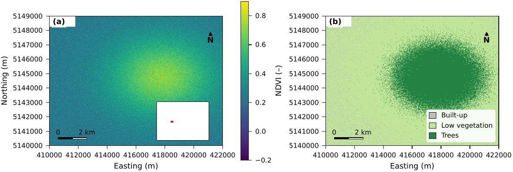

# Geo-Skills

[](https://github.com/FEI-2006/geo-skills/actions/workflows/tests.yml)
[](LICENSE)


[中文](README_CN.md)

AI agent skills for remote sensing, GIS and geography research: publication-ready figures, clean legend layout and journal-style English for geoscience papers.

Each skill is a folder with a `SKILL.md` (the instructions an agent follows) plus references and templates. They work with Claude, Codex and other agents that read `SKILL.md` files.

## Skills

| Skill | Status | What it does |
|---|---|---|
| [geo-figure](skills/geo-figure) | Beta | Maps and charts sized and styled for Elsevier, IEEE, Taylor & Francis and MDPI journals; Python templates, an automatic size and label check, and caption templates |
| [geo-polishing](skills/geo-polishing) | Draft | Polishes or translates manuscript text into clear geoscience English without changing numbers or claims; four modes, worked examples and a Chinese–English glossary |
| [geo-legend](skills/geo-legend) | Beta | Decides where legends and colorbars go: emptiest corner, one shared legend, direct labels or outside placement; keeps the figure size and checks for covered data, overlaps and repeats |

Status labels: **Draft** = rules written, not yet tested on real cases; **Beta** = tested on examples; **Stable** = used on real academic work.



## Design principles

1. **Never change the science.** Skills do not invent data, results or citations, and flag problems instead of silently fixing them.
2. **Follow the journal.** Sizes, resolutions and style rules come from publisher guidelines, cited in the references.
3. **Output first.** Each skill ends with something usable: a figure file, polished text, a checklist.
4. **Self-contained.** Each skill folder works on its own.

## Install

**Claude (claude.ai or the desktop app)**
1. Download a ready-made ZIP from [`dist/`](dist): `geo-figure.zip`, `geo-legend.zip` or `geo-polishing.zip`.
2. Make sure code execution and file creation is turned on in Settings → Capabilities.
3. Go to Customize → Skills, click **+**, choose **Create skill → Upload a skill**, and upload the ZIP.

Skills you add to your Claude account also load in Claude Code when you sign in with the same account.

**Claude Code (from the repository)**

```bash
git clone https://github.com/FEI-2006/geo-skills.git
cp -r geo-skills/skills/* ~/.claude/skills/
```

**Other agents (Codex, etc.)**: copy the whole skill folder into the agent's skills or prompts directory. Keep the `references/` and `templates/` subfolders.

## Repository layout

```
skills/            one folder per skill (SKILL.md, READMEs, references, templates)
dist/              upload-ready ZIPs, rebuilt with scripts/package_skills.py
tests/             checks for skill structure and the Python templates
template/SKILL.md  starting point for a new skill
```

## Development

```bash
pip install numpy pandas matplotlib pytest
python -m pytest -q tests          # structure checks + run both figure templates
python scripts/package_skills.py   # rebuild dist/*.zip
```

## Roadmap

- geo-reviewer: simulated peer review against RSE / TGRS / IJGIS criteria
- geo-gvi: standardized street-view green view index workflow
- geo-data-statement: data availability and code availability statements

## Contributing

See [CONTRIBUTING.md](CONTRIBUTING.md). Changes are listed in [CHANGELOG.md](CHANGELOG.md).

## License

[MIT](LICENSE) © 2026 Xiaoyan Fei
