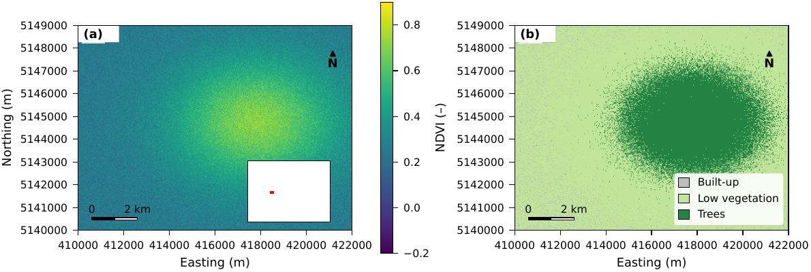
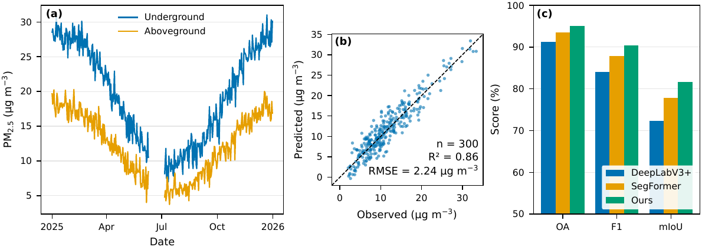

# geo-figure

[中文](README_CN.md)

**Status: Beta** (tested on synthetic data; not yet on a real submission)

Makes publication-ready maps and charts for remote sensing, GIS and geography papers in Python. It sizes figures to the journal's column width, applies colour, unit and labelling rules, and finishes with a pass/fix checklist.

## What it covers

- Study-area maps with a scale bar, north arrow, coordinates and a locator inset
- Continuous rasters (NDVI, temperature, PM2.5) with nodata masked
- Classified and segmentation maps with sharp class edges and a legend
- Time series with real dates and visible data gaps
- Predicted-vs-observed scatter plots with a 1:1 line, n, R² and RMSE
- Grouped bar charts for accuracy metrics (OA, F1, mIoU)
- Width and resolution rules for Elsevier, IEEE, Taylor & Francis and MDPI journals
- An automatic check (`check_figure`) for width, minimum text size and missing axis or colorbar labels
- Caption templates for maps, segmentation results and accuracy figures

## Files

```
geo-figure/
├── SKILL.md                     # instructions the AI agent follows
├── references/journal-specs.md  # column widths and dpi by publisher
├── references/captions.md       # how to write figure captions, with templates
├── templates/geo_map.py         # map helpers (numpy + matplotlib only)
├── templates/geo_chart.py       # chart helpers (numpy + pandas + matplotlib)
└── examples/                    # output of the two templates
```

## Example output

`python templates/geo_map.py`



`python templates/geo_chart.py`



Both examples use synthetic data.

## Requirements

Python 3.9+, numpy, pandas and matplotlib. rasterio, xarray or geopandas are optional; the helpers accept the arrays and extents they produce.
