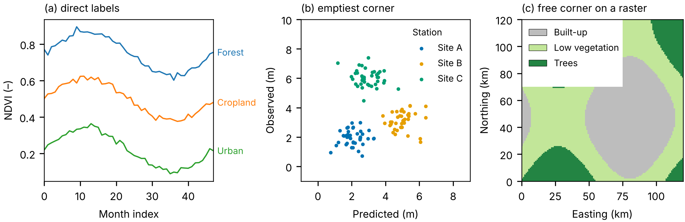
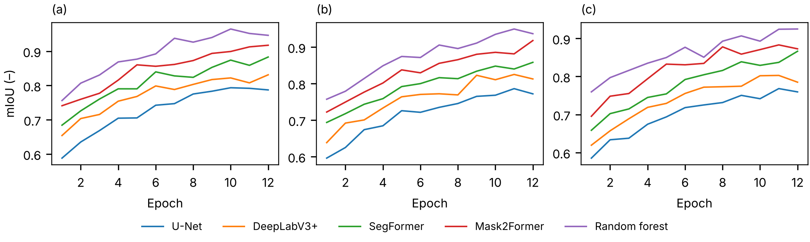

# geo-legend

**Status: Beta** (tested on synthetic data; not yet on a real submission)

Decides where a legend or colorbar goes and lays it out so a figure looks clean in print. It picks between an empty corner, a shared legend, direct labels and a colorbar, then checks the result.

## What it covers

- Auto-placement of a legend in the emptiest corner (lines, scatter points, bars and valid raster cells), keeping scale bar, north arrow and inset free
- One shared legend for multi-panel figures, below or beside the panels, without changing the figure width
- Direct labels at line ends instead of a legend
- Legends for classified and segmentation maps
- Colorbars that line up with the map
- An automatic check (`check_legends`) for legends that cover data, overlap, run off the figure, repeat across panels, have too many entries or use tiny text

## Files

```
geo-legend/
├── SKILL.md                        # instructions the AI agent follows
├── references/placement-guide.md   # reasoning, spacing numbers, common mistakes
├── templates/legend_layout.py      # helpers (numpy + matplotlib only)
└── examples/                       # output of the template
```

## Example output

`python templates/legend_layout.py`

Direct labels, auto-placed legend, and a legend in the free corner of a raster:



One shared legend below three panels:



Both examples use synthetic data.

## Quick use

```python
from legend_layout import place_legend, legend_outside, collect_handles, direct_labels, check_legends

place_legend(ax, title="Station")                        # emptiest corner, or outside if none fits
handles, labels = collect_handles(axes)                  # shared legend for all panels
legend_outside(fig, handles, labels, side="below")
direct_labels(ax)                                        # name lines at their ends
print(check_legends(fig))                                # {'pass': True, 'issues': []}
```

## Requirements

Python 3.9+, numpy and matplotlib. Works alongside `geo-figure` but does not depend on it.
